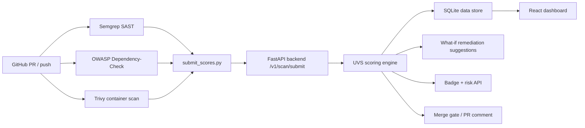

# DevSecOps Pipeline with Automated Vulnerability Scoring (UVS)

This project demonstrates a DevSecOps pipeline that ingests raw scanner output, normalizes it, scores each commit, and visualizes the risk in a dashboard. Findings are weighted using real-world exploit signals (CISA KEV and EPSS), not just raw severity.

> **Status: demo.** The backend and dashboard are tested locally. The GitHub Actions workflow has **not yet been verified against a live repository**, and the dashboard data is sample data, not live scans. See [Known limitations](#known-limitations).


<!-- TODO: add a real screenshot at docs/dashboard.png -->

## Architecture



## Stack

- Backend: FastAPI + SQLAlchemy + SQLite
- Frontend: React + Vite
- Scanners: Semgrep, OWASP Dependency-Check, Trivy
- CI/CD: GitHub Actions

## Quick start (Docker)

```bash
docker compose up --build -d
docker compose ps
# Open http://localhost:3000 (demo data is seeded automatically)
```

## Local development

### Backend

```bash
cd backend
pip install -r requirements.txt
uvicorn main:app --reload
```

### Frontend

```bash
cd frontend
npm install
npm run dev
```

### Run tests

```bash
cd backend
pytest
```

The backend suite currently has 75 passing tests covering score submission and retrieval, history, findings breakdown, KEV/EPSS scoring, what-if suggestions, and badges.

## Scanner commands

Run the three scanner inputs directly if needed:

```bash
# Semgrep
semgrep scan --config p/security-audit --json --output semgrep.json || true

# OWASP Dependency-Check (writes reports/dependency-check-report.json)
dependency-check --project demo-app --scan . --out reports --format JSON --suppression scanners/owasp-suppression.xml || true

# Trivy
trivy image --format json --output trivy.json your-image:tag || true
```

`|| true` keeps the command from failing on findings, so the pipeline decides pass or fail from the UVS threshold instead of the scanner exit code.

The CI workflow in [.github/workflows/devsecops.yml](.github/workflows/devsecops.yml) submits scan JSON to `/v1/scan/submit` and enforces the threshold.

## Dynamic risk badge

When the backend is deployed, replace `YOUR_DEPLOYED_API_HOST` with its public HTTPS host. The SVG badge reflects the latest score and uses the matching risk band color:

```markdown

```

The local SVG endpoint is `http://localhost:8000/v1/badge/demo/acme-webapp.svg`.

## UVS formula

```text
Raw Score = (0.35 × SAST_Score) + (0.40 × SCA_Score) + (0.25 × Container_Score)
Final Score = min(100, Raw Score × Environment_Multiplier × Delta_Factor)
```

Where:
- SAST score = weighted density of Semgrep findings
- SCA score = weighted OWASP findings plus mean CVSS blend
- Container score = weighted Trivy findings
- Environment multiplier: dev=1.0, staging=1.1, prod=1.3
- Delta factor: 0.9 when a commit improves versus the previous commit, otherwise 1.0. This rewards remediation: a commit that lowers risk gets a small bonus.

Example:

```text
SAST = 30
SCA = 60
Container = 40
Raw Score = (0.35 × 30) + (0.40 × 60) + (0.25 × 40)
          = 10.5 + 24 + 10
          = 44.5

Prod environment: ×1.3
Previous score higher: delta reward = 0.9
Final Score = min(100, 44.5 × 1.3 × 0.9)
            ≈ 52.1
```

Risk categories:
- 0 to 20: Low
- above 20 to 50: Medium
- above 50 to 75: High
- above 75 to 100: Critical

### Per-finding weighting (KEV and EPSS)

Before findings are aggregated into the category scores above, each finding is weighted using exploit intelligence:

- **CISA KEV:** if the CVE is in the Known Exploited Vulnerabilities catalog, the finding's weight is multiplied by a KEV multiplier (default `1.25`).
- **EPSS:** the finding's predicted exploitation probability scales its weight, controlled by `EPSS_ALPHA` (default `1.0`).

EPSS values come from an **offline snapshot** (`epss.json`), not a live feed. The reasoning behind the default weights is in the "why these weights" section of [DEMO.md](DEMO.md), and `calibrate_weights.py` can be used to re-tune them. The exact implementation is in `backend/scoring.py`.

## GitHub Action setup

1. Push the repo to GitHub.
2. Deploy the FastAPI backend somewhere reachable from GitHub Actions.
3. Set repo variables / secrets:
   - `SCORING_API_URL` = deployed backend URL, for example `https://uvs-api.example.com`
   - `RISK_FAIL_THRESHOLD` = `75`
   - `DASHBOARD_URL` = optional dashboard URL for PR comments
4. Require the `Aggregate & Score` workflow check in branch protection.
5. The score job posts a PR comment and exits with a non-zero status when the score exceeds the threshold.

Fork-originated pull requests may not have permission to publish comments even when the workflow declares `pull-requests: write`; GitHub restricts fork tokens. The workflow reports that situation as a warning, while the score threshold check still runs.

## Demo data and sample runs

The project includes repeatable demo data so the dashboard can be shown without a live scanner feed.

- Sample seed script: [backend/scripts/post_samples.py](backend/scripts/post_samples.py)
- Demo guide: [DEMO.md](DEMO.md)
- Demo data is labeled as sample/demo in the script and in the dashboard footer.

## Known limitations

- This is a demo project, not a production-grade enterprise platform.
- **The GitHub Actions workflow has not yet been run against a live repository.** Real scanner execution requires a live GitHub repo, a deployed backend URL, and branch protection configuration.
- The seeded findings are representative sample data, not live scan output from real repositories.
- Demo CVE IDs use the `CVE-DEMO-*` namespace; the Log4Shell sample uses the real `CVE-2021-44228` identifier to demonstrate KEV matching. None of these are a claim that the sample repositories were scanned.
- EPSS data is an offline snapshot and is not refreshed automatically.
- Reachability analysis is not implemented. Findings are scored whether or not the vulnerable code is actually reachable.
- The submit endpoint has no authentication yet.
- The project is intended for teaching and presentation, not large-scale multi-org scanning.

## Repository layout

```text
.
├── .github/workflows/devsecops.yml
├── backend/
│   ├── parsers/
│   ├── routers/
│   ├── scripts/
│   ├── services/
│   ├── tests/
│   ├── database.py
│   ├── main.py
│   ├── models.py
│   ├── scoring.py
│   └── requirements.txt
├── frontend/
├── scanners/
├── docker-compose.yml
├── Dockerfile.backend
├── Dockerfile.frontend
├── DEMO.md
├── .env.example
├── README.md
└── docs/
```

## Team

- Akhil Dwivedi
- _Teammate 2_
- _Teammate 3_

Medicaps University, Indore. Minor project.

## License

_Add a license (for example MIT) before publishing._
