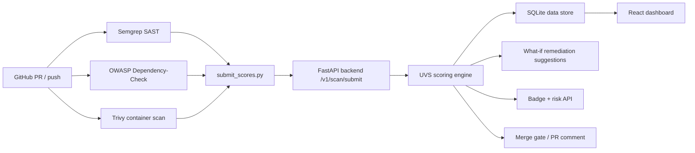

# DevSecOps Pipeline with Automated Vulnerability Scoring (UVS)

This project demonstrates a DevSecOps pipeline that ingests raw scanner output, normalizes it, scores each commit, and visualizes the risk in a dashboard. Findings are weighted using real-world exploit signals (CISA KEV and EPSS), not just raw severity.

> **Status: demo.** The backend and dashboard are tested locally. GitHub Actions has run in this repository before, but the latest observed run failed before scoring; this revised workflow still needs a new GitHub run. The dashboard data is sample data, not live scans. See [Known limitations](#known-limitations).


<!-- TODO: add a real screenshot at docs/dashboard.png -->

## Architecture



## Stack

- Backend: FastAPI + SQLAlchemy + SQLite
- Frontend: React + Vite
- Scanners: Semgrep, OWASP Dependency-Check, Trivy
- CI/CD: GitHub Actions

## Quick start (Docker)

```bash
docker compose up --build -d
docker compose ps
# Open http://localhost:3000 (demo data is seeded automatically)
```

## Local development

### Backend

```bash
cd backend
pip install -r requirements.txt
uvicorn main:app --reload
```

### Frontend

```bash
cd frontend
npm install
npm run dev
```

### Run tests

```bash
cd backend
pytest
```

The backend suite currently has 75 passing tests covering score submission and retrieval, history, findings breakdown, KEV/EPSS scoring, what-if suggestions, and badges.

## Scanner commands

Run the three scanner inputs directly if needed:

```bash
# Semgrep
semgrep scan --config p/security-audit --json --output semgrep.json || true

# OWASP Dependency-Check (writes reports/dependency-check-report.json)
dependency-check --project demo-app --scan . --out reports --format JSON --suppression scanners/owasp-suppression.xml || true

# Trivy
trivy image --format json --output trivy.json your-image:tag || true
```

`|| true` keeps the command from failing on findings, so the pipeline decides pass or fail from the UVS threshold instead of the scanner exit code.

The CI workflow in [.github/workflows/devsecops.yml](.github/workflows/devsecops.yml) starts a temporary local scoring API in the runner, submits scan JSON to `/v1/scan/submit`, and enforces the configured threshold.

## Dynamic risk badge

The workflow uploads a Shields.io-compatible `risk-badge.json` with the scored results. Download and host that JSON at a public URL to use it with Shields.io:

```markdown

```

The backend also exposes a live SVG badge at `/v1/badge/{owner}/{repo}.svg` and Shields.io JSON at `/v1/badge/{owner}/{repo}`. These endpoints use the latest score stored by that backend. A local sample badge is at `http://localhost:8000/v1/badge/demo/acme-webapp.svg`.

## UVS formula

```text
Raw Score = (0.35 × SAST_Score) + (0.40 × SCA_Score) + (0.25 × Container_Score)
Final Score = min(100, Raw Score × Environment_Multiplier × Delta_Factor)
```

Where:
- SAST score = weighted density of Semgrep findings
- SCA score = weighted OWASP findings plus mean CVSS blend
- Container score = weighted Trivy findings
- Environment multiplier: dev=1.0, staging=1.1, prod=1.3
- Delta factor: 0.9 when a commit improves versus the previous commit, otherwise 1.0. This rewards remediation: a commit that lowers risk gets a small bonus.

Example:

```text
SAST = 30
SCA = 60
Container = 40
Raw Score = (0.35 × 30) + (0.40 × 60) + (0.25 × 40)
          = 10.5 + 24 + 10
          = 44.5

Prod environment: ×1.3
Previous score higher: delta reward = 0.9
Final Score = min(100, 44.5 × 1.3 × 0.9)
            ≈ 52.1
```

Risk categories:
- 0 to 20: Low
- above 20 to 50: Medium
- above 50 to 75: High
- above 75 to 100: Critical

### Per-finding weighting (KEV and EPSS)

Before findings are aggregated into the category scores above, each finding is weighted using exploit intelligence:

- **CISA KEV:** if the CVE is in the Known Exploited Vulnerabilities catalog, the finding's weight is multiplied by a KEV multiplier (default `1.25`).
- **EPSS:** the finding's predicted exploitation probability scales its weight, controlled by `EPSS_ALPHA` (default `1.0`).

EPSS values come from an **offline snapshot** (`epss.json`), not a live feed. The reasoning behind the default weights is in the "why these weights" section of [DEMO.md](DEMO.md), and `calibrate_weights.py` can be used to re-tune them. The exact implementation is in `backend/scoring.py`.

## GitHub Action setup

1. In **Settings → Secrets and variables → Actions**, add the repository secret `NVD_API_KEY` with an NVD API key. Dependency-Check requires it; the job caches its data directory between runs.
2. Optionally add the repository variable `RISK_FAIL_THRESHOLD` (defaults to `75`) and `DASHBOARD_URL` (used only in the PR comment and job summary). No deployed scoring service or `SCORING_API_URL` is needed: the score job starts FastAPI on the runner and uses SQLite for that job.
3. Push to `main` or open/update a pull request targeting `main` to run the workflow. It uploads each raw scanner report and a `score-results` artifact containing the score response, complete findings breakdown, and Shields.io badge JSON.
4. The score job fails when `score >= RISK_FAIL_THRESHOLD`. In **Settings → Branches → Branch protection rules** (or the applicable ruleset), require the `Aggregate & Score` status check to block merges.
5. On pull requests, the job creates or updates one report comment with the score, severity, and top Fix first items, including whether each is in CISA KEV.

The workflow grants the score job `pull-requests: write` for its built-in `GITHUB_TOKEN`. On fork-originated pull requests GitHub withholds repository secrets, including `NVD_API_KEY`, so Dependency-Check fails explicitly until the scan runs in a context with that secret. GitHub may also limit the comment token on fork PRs.

## Demo data and sample runs

The project includes repeatable demo data so the dashboard can be shown without a live scanner feed.

- Sample seed script: [backend/scripts/post_samples.py](backend/scripts/post_samples.py)
- Demo guide: [DEMO.md](DEMO.md)
- Demo data is labeled as sample/demo in the script and in the dashboard footer.

## Known limitations

- This is a demo project, not a production-grade enterprise platform.
- The latest observed GitHub Actions run (#3, November 23, 2026) had successful OWASP and Trivy jobs but failed while installing Semgrep: the runner selected Python 3.14, which was incompatible with the installed `pydantic-core` build dependencies. The score job was skipped. This revision pins Python 3.11 for Semgrep and runs scoring in-job, but it has not yet been pushed and rerun on GitHub.
- The seeded findings are representative sample data, not live scan output from real repositories.
- Demo CVE IDs use the `CVE-DEMO-*` namespace; the Log4Shell sample uses the real `CVE-2021-44228` identifier to demonstrate KEV matching. None of these are a claim that the sample repositories were scanned.
- EPSS data is an offline snapshot and is not refreshed automatically.
- The submit endpoint has no authentication yet.
- The project is intended for teaching and presentation, not large-scale multi-org scanning.

## What was verified

- `pytest -q backend\tests`: 75 backend tests passed after the workflow and documentation changes.
- The revised workflow YAML parses, and its embedded summary/badge JavaScript passes `node --check`.
- GitHub Actions run [#3](https://github.com/akhild24/devsecops-uvs-pipeline/actions/runs/45107080297) is a real prior run of the repository workflow: OWASP and Trivy succeeded, Semgrep failed during dependency installation, and scoring did not run. The revised workflow still needs a fresh GitHub-hosted run.

## Repository layout

```text
.
├── .github/workflows/devsecops.yml
├── backend/
│   ├── parsers/
│   ├── routers/
│   ├── scripts/
│   ├── services/
│   ├── tests/
│   ├── database.py
│   ├── main.py
│   ├── models.py
│   ├── scoring.py
│   └── requirements.txt
├── frontend/
├── scanners/
├── docker-compose.yml
├── Dockerfile.backend
├── Dockerfile.frontend
├── DEMO.md
├── .env.example
├── README.md
└── docs/
```

## Team

- Akhil Dwivedi
- _Teammate 2_
- _Teammate 3_

Medicaps University, Indore. Minor project.

## License

_Add a license (for example MIT) before publishing._
